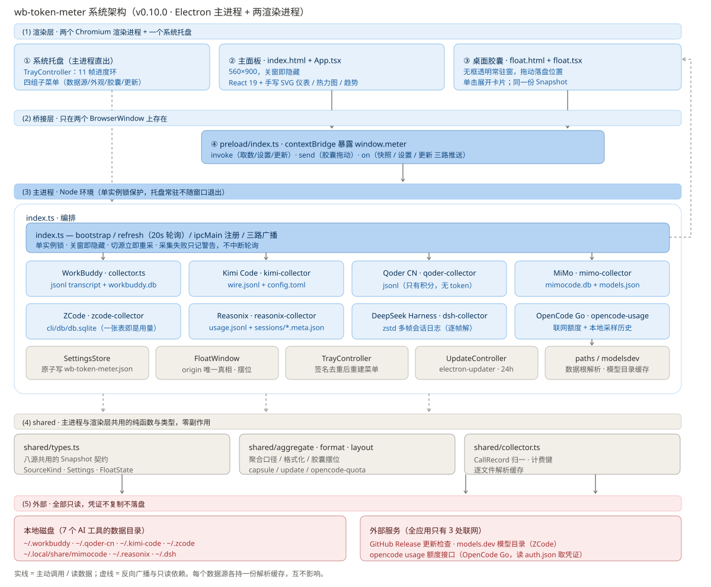
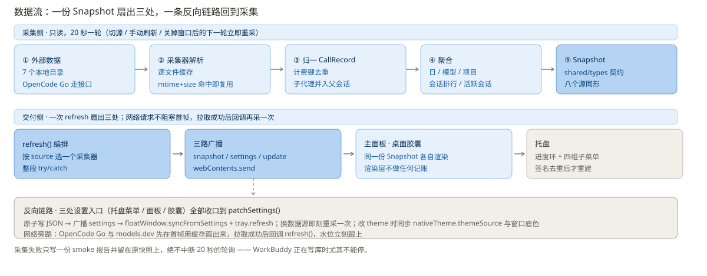

# 系统架构与设计说明

给要改动这个仓库的人看的架构文档。讲**分层、模块职责、数据流、关键取舍**，
以及**加一个新数据源要动哪些地方**。

三份文档的分工：

| 文档 | 讲什么 | 什么时候读 |
| --- | --- | --- |
| [README.md](../README.md) | 各数据源**长什么样**、界面怎么画、使用方式 | 想加数据源、想知道某个字段的口径 |
| 本文件 | **分层与模块边界**、数据谁传给谁、为什么这样切 | 要改代码、要加功能 |
| [AGENTS.md](../AGENTS.md) | 命令、本机环境坑、GitHub 操作、发版流程 | 要跑构建 / 推送 / 排查环境 |

版本基准：v0.10.0。

---

## 1. 定位与硬约束

一句话：**托盘常驻的本地用量计量器** —— 把 WorkBuddy、Qoder CN、Kimi Code、
ZCode、MiMo、Reasonix、DeepSeek Harness 的本地用量，和 OpenCode Go 的订阅额度，
读出来摆到一个小面板、桌面胶囊和系统托盘上。

五条从需求倒推出来的硬约束，架构基本都是绕它们转的：

1. **只读。** 除了更新检查和两个联网额度/目录请求，全程只读用户磁盘；不写别人的数据目录。
2. **不常驻占用资源。** 采集 20 秒一轮、解析结果按 `mtime+size` 缓存，命中就直接复用。
3. **必须能一直活着。** 关掉所有窗口不退出（托盘常驻），采集失败不能中断轮询，
   网络请求不能阻塞首帧。
4. **凭证不落地。** 只从各家自己的 `auth.json` / `config.json` 里读需要的那一个值，
   不复制、不写日志、不进 Snapshot（`QuotaInfo.credential` 只放来源描述）。
5. **八个账本形状不同。** 有的是 token，有的是积分（Qoder CN 只有积分，没有 token），
   有的连 token 都没有只有额度（OpenCode Go，且要联网）。界面不能假设同一套字段。

---

## 2. 总体架构



分四层，边界是硬性的：

```
src/
├── main/        主进程（Node）—— 采集、编排、窗口、托盘、更新
├── preload/     桥 —— 只做 contextBridge 转发，不含业务逻辑
├── renderer/    渲染层（React 19）—— 主面板与桌面胶囊两个入口
└── shared/      主进程与渲染层共用的类型与纯函数（零副作用）
```

| 层 | 成员 | 能不能碰 |
| --- | --- | --- |
| 渲染层 | `App.tsx`、`float.tsx`、`theme.ts` | 只能拿 `window.meter`，**不能**碰 fs / 数据库 / 子进程 |
| 桥 | `preload/index.ts` | 只能 `ipcRenderer` 转发，不缓存状态 |
| 编排 | `main/index.ts` | 决定采谁、什么时候广播、失败怎么办 |
| 采集 | `shared/*-collector.ts`、`main/opencode-usage.ts`、`main/modelsdev.ts` | 读磁盘 / 发网络请求，产出 Snapshot |
| 服务 | `settings.ts`、`tray.ts`、`float.ts`、`updater.ts`、`paths.ts` | 被编排层持有，彼此不直接依赖 |
| 纯函数 | `shared/types.ts`、`format.ts`、`aggregate.ts`、`layout.ts`、`capsule.ts`、`update.ts` | 无 I/O，两边都能用 |

三条容易踩的边界：

- **网络只在主进程。** 渲染层发不出请求，`opencode-usage.ts` 与 `modelsdev.ts` 也不碰渲染。
- **类型只有一个出处。** `shared/types.ts` 是 Snapshot 的唯一定义；
  渲染层改字段名时 typecheck（`tsconfig.web.json`）会直接报错，不会静默不一致。
- **主进程与渲染层"各记一份"的地方是刻意减到最少的。** 主题是唯一例外外的例外：
  走 `nativeTheme.themeSource`，渲染层用 `prefers-color-scheme` 读，两边不需要同步消息。

---

## 3. 核心模块

### 3.1 编排 `main/index.ts`（1186 行，入口与中枢）

进程启动后按这个顺序走：拿单实例锁 → `SettingsStore` 读设置 →
`applyTheme`（必须在建窗口**之前**，窗口底色是创建参数）→ 建 `FloatWindow` →
建 `TrayController` → 建主窗口 → 安排更新检查 → 第一次 `refresh()` →
`setInterval(refresh, 20_000)`。

几个只有这里能决定的事：

- **`refresh(force)`** 是整个应用唯一的取数入口：按 `settings.source` 挑一个采集器，
  拿到 Snapshot 后扇出 —— `tray.update()`、主窗口 `webContents.send('snapshot')`、
  `floatWindow.send('snapshot')`。整段包在 try/catch 里，**采集失败只写 smoke 报告，
  留着旧快照继续转**（`index.ts:302`）。
- **各源各持一份解析缓存**（`workbuddyCache` / `kimiCache` / `qoderCache` /
  `reasonixCache` / `dshCache`），切源不会把对方的增量缓存冲掉。
- **两个联网客户端都是懒创建的**：只有真的切到 OpenCode Go / ZCode 才实例化，
  才会去读 `auth.json` 或发请求。
- **`patchSettings()` 是设置的唯一收口**（`index.ts:353`）。托盘菜单、面板、
  胶囊三处入口都调它：原子落盘 → 广播 settings → 同步胶囊窗口 → 刷新托盘 →
  按需立刻重采 / 改主题 / 同步更新开关。任何新设置项都应该在这里被照顾到。

### 3.2 采集层

一个源一个文件，职责单一：把自家数据整理成会话列表（WorkBuddy 例外，它还要对积分），
剩下的统计口径交给 `shared/aggregate.ts`。

| 源 | 采集器 | 主要输入 | 计量维度 |
| --- | --- | --- | --- |
| WorkBuddy | `shared/collector.ts` | `projects/**/*.jsonl` + `workbuddy.db` | token **+ 积分** |
| Qoder CN | `shared/qoder-collector.ts` | `projects/**/*.jsonl` | **只有积分**（无 token） |
| Kimi Code | `shared/kimi-collector.ts` | `sessions/**/wire.jsonl` + `config.toml` | token |
| ZCode | `shared/zcode-collector.ts` | `cli/db/db.sqlite` | token |
| MiMo | `shared/mimo-collector.ts` | `mimocode.db` + `models.json` | token |
| Reasonix | `shared/reasonix-collector.ts` | `usage.jsonl` + `sessions/*.meta.json` | token |
| DeepSeek Harness | `shared/dsh-collector.ts` | `~/.dsh/sessions/**/*.jsonl.zstd` | token |
| OpenCode Go | `main/opencode-usage.ts` | `auth.json` + usage 接口 | **只有额度**（联网） |

`shared/collector.ts` 除了 WorkBuddy 的采集，还承担三件被其它采集器复用的事：
`CallRecord` 归一、`billingKey()`（计费键口径）、`parseTranscriptFile()` 的 mtime 缓存。
WorkBuddy 那条链路**刻意不复用** `aggregate.ts` —— 它要拿计费键去数据库对账，
口径和"只有 token"的源差得远，混进去有碰坏它的风险。

### 3.3 shared 纯函数层

| 文件 | 职责 |
| --- | --- |
| `types.ts` | Snapshot / SourceKind / Settings / FloatState 等全部契约 |
| `format.ts` | 数字时间格式化，以及"这个源有没有 token / 积分 / 额度"的判定（`hasTokens` 等） |
| `aggregate.ts` | 会话列表 → Snapshot 的公共聚合（Kimi / ZCode / MiMo / Reasonix / DSH / Qoder 走这条） |
| `layout.ts` | 胶囊摆位的全部算术：窗口尺寸、卡片朝上朝下、`origin` 反推 |
| `capsule.ts` | 五档胶囊主题的解析与实心底色 |
| `update.ts` | 版本号比较、状态文案（渲染层与托盘共用一份文案） |
| `opencode-quota.ts` | 额度窗口的摘要与重置时间措辞 |
| `collector.ts` | 归一、计费键、文件解析缓存（见上） |

### 3.4 服务层

- **`settings.ts`** —— `SettingsStore`，临时文件 + `fsync` + `rename` 原子替换；
  逐字段校验，配置被手改坏时只回退那一个字段而不是整体重置。
- **`tray.ts`** —— `TrayController`。进度环按 10% 一档从 11 帧预生成图里取；
  菜单**签名去重**（`signature` 里含 generatedAt、额度窗口值、更新状态、全部胶囊设置），
  `refresh()` 会强制清签名重建一次 —— 因为系统自己挪 `radio` 圆点，
  设置改完不重建就会出现"圆点在新档位、标题还停在旧档位"。
- **`float.ts`** —— `FloatWindow`。**胶囊在屏幕上的位置（`origin`）是唯一真相**，
  窗口摆哪由它算出来；收起/展开共用同一套 `floatWindowBounds()`，所以来回切是幂等的。
  用 `setBounds` 而不是 `setPosition`（后者在 Win11 150% 缩放下每调一次宽高各 +1）。
- **`updater.ts`** —— `UpdateController`，包 `electron-updater`。
  开发模式与免安装版显式报"不支持"，**不假装"已是最新"**；
  英文错误翻成可看懂的一句话（`app-update.yml` → 缺少更新配置等）。
- **`paths.ts`** —— 每个源的数据根目录（都支持 `WB_TOKEN_METER_*_DIR` 环境变量覆盖）、
  托盘图取用、窗口加载与加固。

### 3.5 桥与渲染层

`preload/index.ts` 只做一件事：`exposeInMainWorld('meter', api)`。
两个值得记住的点：

- 胶囊主题是**启动参数** `--wbm-capsule-theme=` 带进来的，preload 在样式表之前
  就把 `<html data-capsule>` 写好 —— 走 IPC 问一轮的话，首帧画错颜色肉眼可见地闪一下。
- 拖动走 `ipcRenderer.send`（不需要回值），取数走 `invoke`。

渲染层两个入口：`App.tsx`（面板，`index.html`）和 `float.tsx`（胶囊，`float.html`）。
两者都只消费 Snapshot，不做任何记账；尺寸、主题、摆位的计算全部在 shared 与主进程，
**渲染层只负责照摆**（`FloatState.side` / `alignRight` 由主进程算好再推过来）。

---

## 4. 数据流



### 4.1 采集主链路

```
定时 20s / 切源 / 手动刷新 / IPC snapshot:refresh
        │
        ▼
refresh(force) ── 按 settings.source 选采集器（各源各一份解析缓存）
        │          读磁盘（只读）或联网（仅 opencode / models.dev）
        ▼
CallRecord[] → 聚合（日 / 模型 / 项目 / 会话 / 活跃会话）
        ▼
Snapshot（shared/types.ts 契约）
        │
        ├─► tray.update(snapshot)            签名变了才重建菜单
        ├─► mainWindow.webContents.send('snapshot')
        └─► floatWindow.send('snapshot')     窗口没 loaded 就丢弃
```

**两条网络旁路同构**：OpenCode Go 的额度与 ZCode 的 models.dev 目录，
都是"先把缓存画出来（返回 false）→ 后台 pull → 拉到了回调 `refresh()`"。
`pull()` 自带去重与退避，所以重入不会绕成死循环；
20 秒的同步轮询**绝不会被网络卡住**。

### 4.2 设置反向链路

```
托盘菜单 / 面板 / 胶囊任一处改动
      ▼
patchSettings(patch) ── 唯一收口
      ├─ SettingsStore.patch()            原子写 JSON
      ├─ broadcastSettings()              推 'settings' 给两个窗口
      ├─ floatWindow.syncFromSettings()   （实心底色变了才重建窗口）
      ├─ tray.refresh()                   强制清签名重建
      ├─ patch.source 变了 → refresh()    立刻重采，不等下一轮轮询
      └─ patch.theme 变了 → applyTheme()  nativeTheme + 窗口底色
```

### 4.3 IPC 契约

23 个通道，全部集中在 `main/index.ts:1112-1186` 与 `main/float.ts` 注册。

**invoke（渲染层 → 主进程，有回值）**：
`snapshot:get` / `snapshot:refresh` / `data:open-dir` / `app:quit` / `app:info` /
`app:open-home` / `settings:get` / `settings:update` / `float:state` /
`update:get` / `update:check` / `update:download` / `update:install` / `update:open-page`

**send（渲染层 → 主进程，单向，高频）**：
`float:move`(dx,dy) / `float:toggle-card` / `float:collapse-card` /
`float:open-panel` / `float:context-menu`

**push（主进程 → 渲染层）**：`snapshot` / `settings` / `update` / `float:expanded`

`app:open-home` 与 `update:open-page` 的地址**写死在主进程**，
不接受渲染层传来的任意 URL —— 否则就是一个开放重定向口子。

---

## 5. 关键设计决策

按"改动时最容易把它改坏"的顺序排。细节成因在 README / 代码注释里，这里只留结论。

1. **解析缓存按源隔离。** 八个 Map 分别持有。`collector.ts` 里那份 `ParseCache`
   被多个源共用时靠 `mtimeMs + size` 判命中，一旦把缓存做成全局单例，
   切源会把另一边的增量结果一起冲掉。
2. **网络不阻塞首帧。** 额度源与模型目录都是"先画缓存、到了再广播"。
   改成一个 `await` 就会把 20 秒轮询拖成偶发卡顿。
3. **采集失败不抛。** `WorkBuddy` 可能正在写 `workbuddy.db`（带 `-wal/-shm`），
   读失败就留旧快照 + 一条 warning，下 20 秒再来一次。
4. **胶囊位置 `origin` 是唯一真相。** 窗口 bounds 由它反推，贴边收紧的结果又写回它。
   两边各存一份"窗口在哪"就会一格一格漂。
5. **展开不新建窗口。** 只是把同一个窗口撑大并让胶囊原地不动，所以收起/展开幂等。
6. **透明 vs 实心底色 = 重建窗口。** `transparent` 是创建参数，运行期改不了，
   `syncFromSettings()` 里检测到 `floatSolidBackground` 变了就 destroy + show。
7. **胶囊主题走启动参数。** 面板的 `theme` 与胶囊的 `floatTheme` 是**两条独立的轴**；
   两者都不通过 IPC 问，靠 `additionalArguments` + preload 抢在首帧前落 `<html>`。
8. **窗口底色是主进程给的。** 它是创建参数，CSS 管不到；
   `#0B0E16` / `#EDF0EC` 必须和 `styles.css` 的 `--paper` 对上，否则冒出来那一帧会闪。
9. **托盘菜单签名去重，但 `refresh()` 强制清签名。** 签名挡的是"同一份快照被反复喂进来"，
   挡不住"设置改完还没到下一份快照"；radio 圆点又是系统挪的，必须整块重建才一致。
10. **工作台标题栏（WCO）只在 win32 接管。** 原生 caption 会被系统强调色染色且不随主题变；
    `symbolColor` / `CAPTION_HEIGHT` 改了要同步 `styles.css` 的 `.app-caption`。
11. **积分口径以数据库为权威（WorkBuddy）。** `credits` = 库里所有计费记录之和，
    `attributedCredits` / `unattributedCredits` 分开报，总额不会平白少一截。
    计费键认 `conversationRequestId`，退回 `traceId` —— 只认 traceId 会"总额对、今日全 0"。
12. **没有该字段就整块收起，不画 0。** Qoder CN 没有 token、OpenCode Go 没有 token
    也没有会话，界面按 `hasTokens` / `hasCredits` / `hasQuota` 换一套卡片，
    比显示一片 0 更有用。

---

## 6. 加一个新数据源要动的地方

按顺序过一遍，漏一步就会静默返回 0：

1. `shared/types.ts` —— 通常不用改（Snapshot 是同形的）；只有新字段才加。
2. 新建 `src/shared/<name>-collector.ts`，导出 `collect<Name>Snapshot({ <dir>, cache, now })`，
   产出 `SourceSession[]` 交给 `shared/aggregate.ts` 出 Snapshot。
   WorkBuddy 那种"要对账"的口径才自己聚合。
3. `shared/format.ts` —— `SOURCE_ORDER` 加一项（顺序即面板按钮与托盘子菜单的顺序）、
   `sourceLabel()` 加一项；新维度 token 类型（有没有思考 token）在 `hasReasoning()` 里加。
4. `main/paths.ts` —— 加 `<name>Dir()`（带 `WB_TOKEN_METER_<NAME>_DIR` 覆盖）。
5. `main/index.ts` —— `sourceDir()` 加分支、`refresh()` 加分支、
   在 `sourceDir` 的 else 链里别让它掉进 workbuddy 分支。
6. `main/tray.ts` 与 `main/float.tsx` —— 托盘/胶囊自动跟随 `SOURCE_ORDER`，通常不用改；
   如果新源没有 token 或有额度，检查 `hasTokens` / `hasQuota` 的判定。
7. 渲染层 `App.tsx` —— 分段按钮自动出现；只有新源有**专属卡片**（如额度视图）时才加分支。
8. 验证：`pnpm test:core` 与 `pnpm test:ci`（无头跑解析与聚合，`test:core` 用本机真实数据、
   `test:ci` 把家目录指到空目录，两条都要过）；GUI 端跑一遍自检
   （`WB_TOKEN_METER_SMOKE=1 WB_TOKEN_METER_SMOKE_EXIT=1`），它会逐个点数据源再切回来，
   并断言 DOM 行数与会话行数对得上。

---

## 7. 已知边界

- **ZCode 的历史只从用量表建库那天起。** 更早的 `rollout/model-io-*.jsonl` 不解析。
- **OpenCode Go 拿不到剩余金额，也拆不到单个模型** —— 服务端只回三个百分比。
  趋势曲线是本地记的采样（30 天滚动，半小时一条心跳）。
- **Qoder CN 的 `billable` 字段语义未明**，本机 393 行里 379 行为 false 且带非零 credits，
  当前一律入账，待与官方用量页对账后定口径。
- **上下文上限拿不到时只报已用 token，不编百分比**（ZCode 走远程 provider、
  模型不在本地 config 也不在 models.dev 目录里时）。
- **改进程的自检**（`WB_TOKEN_METER_SMOKE=1`）写的是 `%TEMP%/wbtm-smoke`，
  只在 CI 与排障时用，正常用户跑不到。
